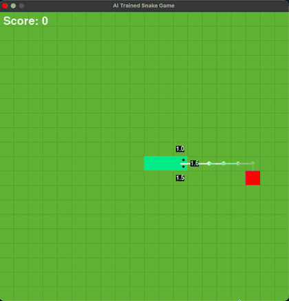

# AI-snakegame

A Snake game in pygame, plus an AI that learns to play it with Deep Q-Learning (PyTorch).



The white line shows where the snake plans to go next. The numbers around its head
are how good it thinks each move is (the yellow one is its choice).

## Setup

```bash
python3 -m pip install -r requirements.txt
```

## Run

```bash
# watch the trained AI play, showing its planned path
python3 evaluate.py --model linkedin_model.pth --games 5 --watch --think 30

# train your own (saves to model.pth)
python3 train.py --episodes 500

# play it yourself (arrow keys / WASD, Space to restart)
python3 snake.py

# run the tests
python3 test_snake.py
```

`python3 train.py --help` and `python3 evaluate.py --help` list all options.

## How it works

Each move, the snake sees 14 numbers:

- **Danger**: is there a wall or body one cell straight, right or left?
- **Direction**: which way it is heading.
- **Food**: is the apple left, right, up or down?
- **Free space**: how much of the board it could still reach after each move,
  so it avoids trapping itself.

It picks one of 3 moves: straight, turn right or turn left.

Rewards: **+10** for an apple, **-10** for dying, **0** otherwise.

A small neural network (14 → 128 → 3) estimates a **Q-value** for each move: the total
reward it expects to collect if it makes that move. It picks the highest one.

Training uses the standard DQN tricks:

- **Experience replay**: learns from random samples of past moves, not just the latest one.
- **Target network**: a slowly updated copy of the network that keeps training stable.
- **ε-greedy**: starts by moving randomly, then relies more on what it learned.

## Files

| File | What it does |
|------|--------------|
| `snake.py` | The game |
| `model.py` | The neural network |
| `agent.py` | The DQN agent (replay buffer, target network, exploration) |
| `train.py` | Training loop |
| `evaluate.py` | Watch or score a trained model |
| `test_snake.py` | Tests |
| `linkedin_model.pth` | A trained model |
